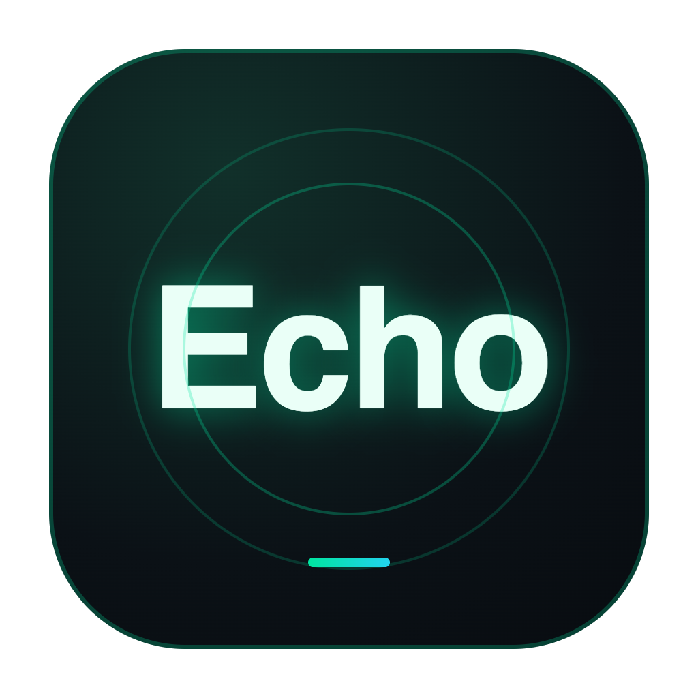

<div align="center">



# Echo by VRSecLabs

**A private AI assistant that runs entirely on your computer.**
Reminders, calendar, expenses, card bills, smart home and your own APIs, from one shortcut, without sending a word to the cloud.

[Download](https://github.com/VRSECLABS-PVT-LTD/echo/releases) · [Privacy](PRIVACY.md) · [Security](SECURITY.md) · [vrseclabs.in](https://vrseclabs.in) · [security@vrseclabs.in](mailto:security@vrseclabs.in)

  

</div>

---

## Why Echo

Most AI assistants send everything you say to a server. Echo doesn't. It runs a local AI model through [Ollama](https://ollama.com), keeps your data encrypted on your own disk, and shows you every connection it makes outside your machine. Then it gets out of your way: press a shortcut, type, done.

| | Echo | Typical cloud assistant |
|---|---|---|
| Where the AI runs | Your computer | Someone else's server |
| Account required | No | Yes |
| Works offline | Yes, after setup | No |
| Telemetry / analytics | None | Usually |
| Your data at rest | AES-256-GCM, key in your OS keychain | On their servers |
| Source code | Open (GPL-3.0) | Closed |

## Features

- **Spotlight-style chat.** Press <kbd>⌥ Space</kbd> on macOS or <kbd>Ctrl Shift Space</kbd> on Windows/Linux from anywhere. Replies stream in instantly.
- **Reminders and alerts.** "Remind me to take my medicine every day at 9pm." One-off, daily, weekly or monthly, delivered as native notifications. Missed ones fire as soon as Echo is back.
- **Calendar.** "Meeting with Rahul tomorrow at 3pm for 30 minutes." Added to Calendar on macOS, or opened as an `.ics` event in your default calendar app on Windows/Linux, with an automatic heads-up reminder.
- **Expense tracking.** "Spent 450 on lunch with my HDFC credit card." Credit and debit spends, categories, and monthly summaries.
- **Card bill reminders.** "My HDFC bill is due on the 20th." Alerts before the due date, on the day, and if it's overdue. Say "paid HDFC" to stop them.
- **Memory.** Echo remembers what you tell it ("my doctor is Dr. Mehta") and forgets on request.
- **Smart home.** Discovers devices on your network (HomeKit, Chromecast, Hue, Matter, printers) and controls them through a local [Home Assistant](https://www.home-assistant.io). Every action needs your approval.
- **Your own APIs.** Import any OpenAPI / Swagger schema, add a token, and Echo can call it. Tokens are encrypted, requests are locked to the host you set, and every write asks first.
- **Calls.** "Call Mom" places the call through your iPhone (macOS Continuity) or Phone Link (Windows), after you approve it.
- **Bluetooth.** Lists connected Bluetooth devices.

## Privacy by design

- **On-device AI.** The model runs locally via Ollama on `127.0.0.1`.
- **Encrypted at rest.** Every data file is encrypted with AES-256-GCM. The key is sealed by macOS Keychain, Windows DPAPI, or GNOME Keyring / KWallet on Linux.
- **Local-only mode (on by default).** Blocks any request that would leave your local network.
- **Network activity log.** Settings → Privacy lists every outside connection: setup downloads, links you open, APIs you allow.
- **No telemetry, no accounts, no crash reporting.** Chromium background networking, component updates and pings are switched off. App windows can't load remote content at all.
- **One-click erase.** Settings → Privacy → *Erase all Echo data* deletes everything, including the encryption key.

Full details are in [PRIVACY.md](PRIVACY.md).

## Install

### 1. Download Echo

Grab the installer for your system from [Releases](https://github.com/VRSECLABS-PVT-LTD/echo/releases):

| System | File |
|---|---|
| macOS (Apple Silicon / Intel) | `Echo-x.y.z-arm64.dmg` / `Echo-x.y.z.dmg` |
| Windows 10/11 | `Echo-Setup-x.y.z-x64.exe` |
| Linux | `Echo-x.y.z.AppImage` or `echo-vrseclabs_x.y.z_amd64.deb` |

Each release includes `SHA256SUMS` files so you can verify downloads.

> **First launch on macOS:** current builds are ad-hoc signed, not yet notarized by Apple. Right-click **Echo.app → Open** the first time, or allow it in **System Settings → Privacy & Security**.
> **Windows:** SmartScreen may warn about an unrecognised publisher. Choose **More info → Run anyway**.

### 2. Follow the setup wizard

On first launch, Echo walks you through:

1. Installing **Ollama**, the free, open-source local AI engine. Echo detects it automatically.
2. Choosing a model for your hardware:

   | Model | Size | Best for |
   |---|---|---|
   | **Echo Fast** (Llama 3.2 3B) | 2.0 GB | Most computers (8 GB+ RAM). Instant replies. *Recommended.* |
   | **Echo Lite** (Llama 3.2 1B) | 1.3 GB | Older or 4–8 GB RAM machines |
   | **Echo Pro** (Qwen 2.5 7B) | 4.7 GB | 16 GB+ RAM, better reasoning |

3. Downloading and verifying the model (SHA-256), then warming it up for instant replies.

After that, Echo works fully offline. It lives in your menu bar as **VRSeclabs** (system tray on Windows and Linux).

## Usage

Press the shortcut and type naturally:

```text
remind me to drink water in 20 minutes
remind me every monday at 10am to send the report
add a dentist appointment on 2026-12-03 at 5pm
I spent 1200 on groceries with my debit card
how much did I spend this week?
my axis card bill is due on the 5th
paid axis
remember that I'm allergic to penicillin
scan my network
turn off the bedroom light
call +91 98765 43210
```

| Shortcut / command | Action |
|---|---|
| <kbd>⌥ Space</kbd> / <kbd>Ctrl Shift Space</kbd> | Show / hide Echo (change in Settings) |
| <kbd>Enter</kbd> · <kbd>Shift Enter</kbd> | Send · new line |
| <kbd>Esc</kbd> | Hide |
| `/settings` · `/privacy` · `/clear` | Open settings · privacy panel · reset the conversation |

## Platform support

| Feature | macOS | Windows | Linux |
|---|---|---|---|
| Chat, reminders, expenses, bills, memory | Yes | Yes | Yes |
| Notifications | Yes | Yes | Yes |
| Calendar | Calendar.app | `.ics` file | `.ics` file |
| Contact lookup for calls | Yes | No (give a number) | No (give a number) |
| Phone calls | iPhone Continuity | Phone Link | Default `tel:` handler |
| Network discovery | Yes | Yes | Yes |
| Bluetooth devices | Yes | Paired & present | `bluetoothctl` |
| Encrypted storage | Keychain | DPAPI | GNOME Keyring / KWallet* |

\* Without a running keyring, Linux falls back to weak key protection, and Settings → Privacy warns you about it.

## Build from source

Requirements: Node.js 22+, [Ollama](https://ollama.com/download).

```bash
git clone https://github.com/VRSECLABS-PVT-LTD/echo.git
cd echo
npm install
npm start            # run in development
npm test             # unit tests (no model needed)
npm run test:model   # end-to-end agent tests (needs Ollama + llama3.2:3b)
npm run dist         # build installers for your current OS into dist/
```

Releases for all three platforms are built by GitHub Actions when a `v*` tag is pushed (see `.github/workflows/release.yml`).

### Project layout

```text
main.js            Electron main process: windows, tray, hotkey, IPC, privacy hardening
agent.js           Local agent loop (Ollama streaming, tool calling, warm-up)
tools.js           Reminders, calendar, expenses, bills, memory, network, calls…
integrations.js    OpenAPI import + guarded API calls
store.js           Encrypted local storage (AES-256-GCM)
platform.js        macOS / Windows / Linux specifics
scheduler.js       Reminder and bill alerts
renderer/          Chat, setup wizard and settings UIs (sandboxed, strict CSP)
test/              Unit and end-to-end tests
```

## Support and bug reports

Found a bug, a security issue, or have feedback? Email **[security@vrseclabs.in](mailto:security@vrseclabs.in)**, or use **Report a problem…** in Echo's menu. Security reports are handled privately (see [SECURITY.md](SECURITY.md)).

## Contributing

Pull requests are welcome. See [CONTRIBUTING.md](CONTRIBUTING.md).

## License

Echo is free software, licensed under the [GNU General Public License v3.0](LICENSE).
Copyright © 2026 VRSecLabs.

Echo uses third-party open models (Llama 3.2 by Meta, Qwen 2.5 by Alibaba) through Ollama. Each model is subject to its own license.

<div align="center"><sub>Built with care by <a href="https://vrseclabs.in">VRSecLabs</a>. Your data, your device.</sub></div>
